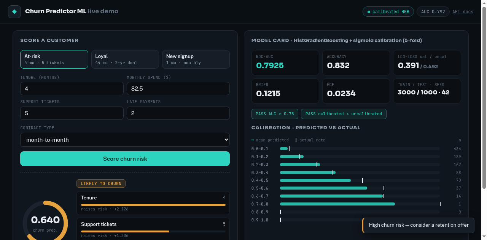

# Churn Predictor ML

Calibrated customer-churn scoring: **HistGradientBoosting + sigmoid calibration**,
served over FastAPI with a demo UI that explains every prediction (top-3 drivers
from a logistic-regression surrogate).



## Why calibration?

Raw classifiers rank well but their probabilities lie — a "70% churn risk" that
churns 40% of the time breaks retention budgets. This project optimizes
**honest probabilities**: log-loss 0.391 (vs 0.492 uncalibrated), ECE 0.023,
with a 10-bin calibration table in the eval report and right in the UI.

## Run it

```bash
./demo.sh            # data → train → eval → API on :8030 (offline, keyless)
```

Then open `http://127.0.0.1:8030/ui`, or:

```bash
curl -X POST :8030/score -H 'Content-Type: application/json' \
  -d '{"tenure_months":4,"monthly_spend":82.5,"support_tickets":5,
       "late_payments":2,"contract_type":"month-to-month"}'
```

## Model card

| metric | value |
|---|---|
| model | HistGradientBoosting + sigmoid calibration (5-fold) |
| train / test | 3000 / 1000 (seed 42, stratified) |
| ROC-AUC | 0.7925 (gate ≥ 0.78) |
| accuracy | 0.832 |
| log-loss cal / uncal | 0.391 / 0.492 |
| Brier / ECE | 0.1215 / 0.0234 |
| data | synthetic, seeded (`data/gen_customers.py`), base churn ~18% |

## Layout

```
data/gen_customers.py  seeded synthetic customers (documented as synthetic)
train.py               pipeline + calibration → models/model.joblib
eval.py                metrics + calibration table + gates → eval/report.json
src/api.py             FastAPI: /score, /model-info, /ui
src/static/ui.src.html demo UI source (fonts inlined → ui.html)
tests/                 19 pytest: gates, determinism, API shapes, calibration
docs/DEPLOY.md         Docker + Hugging Face Spaces
```

## Evals gate deploys

`eval.py` exits non-zero unless AUC ≥ 0.78 **and** calibrated log-loss beats
uncalibrated. No silent model regressions.

Built hands-on with AI coding tools (**Claude Code**) for planning, implementation,
and review — every metric above reproduces from `./demo.sh`.
